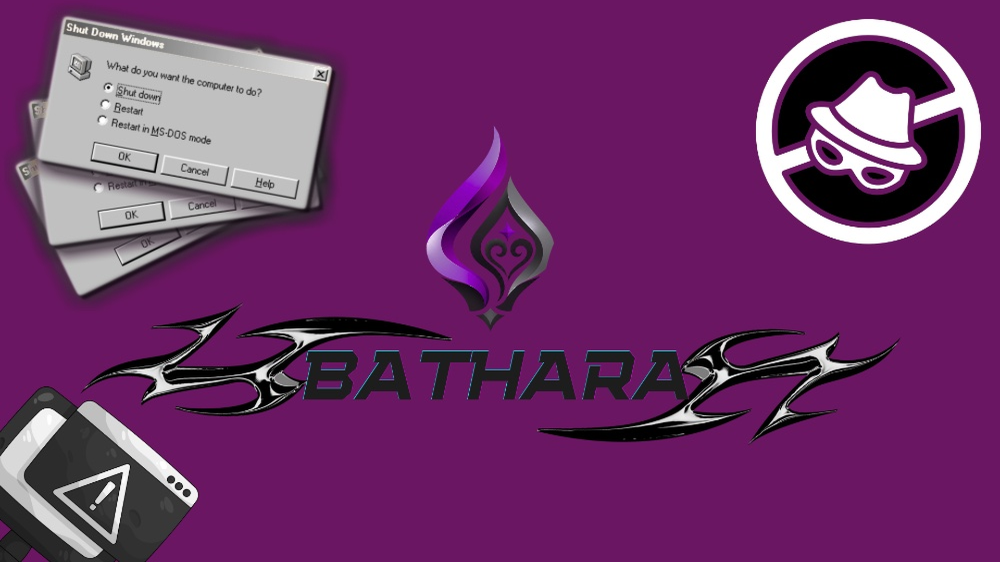
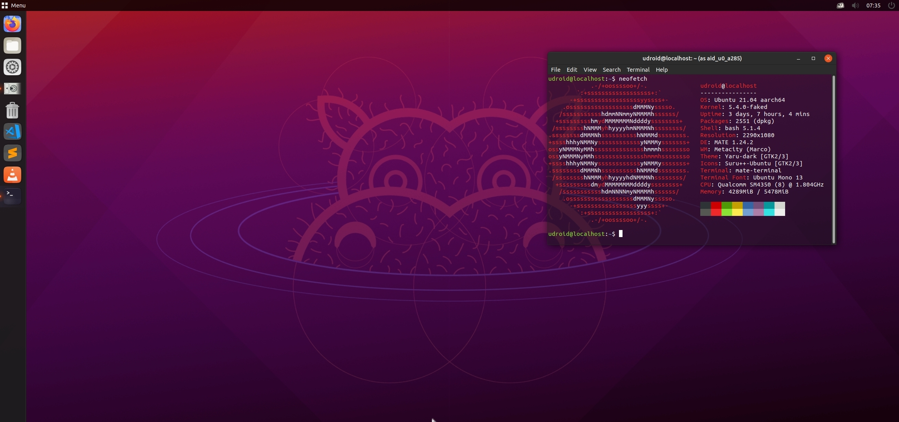

<div align="center">

</div>
<p align="Center">

</p>
<p align="Center">


</p>

<p align="Center">

</p>

<div align="center">


</div>

<p href="https://visitorbadge.io/status?path=https%3A%2F%2Fgithub.com%2FRandomCoderOrg%2Fubuntu-on-android" align=center><p>

<p align="center">
  
</p>

<h2 align="Center">BHATARA OS v2.0.1.2</h2>

BHATARA OS (v2.0.1.2) is a utility allowing you to install pre-configured BHATARA with GUI, development tools, and software on top of Android without root via PRoot and Termux. Check the [disclaimer](md/desclaimer.md) before starting. 


[](https://discord.gg/h7wZ9BfbU9)


codename = `udroid`

## uDroid for Android

Prefer an app? [uDroid for Android](https://github.com/RandomCoderOrg/udroid-app) provides a standalone interface for installing and using Linux systems. It is currently in early development; download the latest build from [GitHub Releases](https://github.com/RandomCoderOrg/udroid-app/releases).

## Installation


Before you install, please read the [wiki](https://udroid-rc.gitbook.io/) and [disclaimer](md/desclaimer.md). To install stable release of `udroid` filesystem run

```bash
. <(curl -Ls https://bit.ly/udroid-installer)
```

**for fresh termux installation**

```bash
apt update && apt upgrade -y
. <(curl -Ls https://bit.ly/udroid-installer)
```

**To install just the `udroid` tool**

```bash
apt update && apt upgrade -y
apt install git -y
git clone https://github.com/RandomCoderOrg/fs-manager-udroid
cd fs-manager-udroid
bash install.sh
udroid install jammy:xfce4
```

For advanced usage, check [this.](https://github.com/RandomCoderOrg/fs-manager-udroid/blob/main/README.md)

**Apply BHATARA OS v2.0.1.2 wallpaper & display theme**

```bash
bash scripts/apply-bhatara-theme.sh
```


## Status
> ### Current Release

| Distribution  | XFCE4 | MATE | GNOME | RAW |
|:-------------- |:------:|:------:|:-:|:-----:|
| [BHATARA Resolute (26.04) LTS](https://docs.udroid.org/suites/ubuntu-26.04-lts) | - | - | - | ✔ |
| [BHATARA Noble (24.04) LTS](https://docs.udroid.org/suites/ubuntu-24.04-lts) | - | - | - | ✔ |
| [BHATARA Jammy (22.04) LTS](https://docs.udroid.org/suites/ubuntu-22.04-lts) | ✔ | ✔ | ✔ | ✔ |

> ### Non-LTS Release

| Distribution  | XFCE4 | MATE | GNOME | RAW |
|:-------------- |:------:|:------:|:-:|:-----:|
| [BHATARA Questing (25.10)](https://docs.udroid.org/suites/ubuntu-25.10) | - | - | - | ✔ |
| [BHATARA Plucky (25.04)](https://docs.udroid.org/suites/ubuntu-25.04) | - | - | - | ✔ |

> ### End of Life distros

| Distribution  | XFCE4 | MATE | RAW |
|-------------- |------|------|-----|
| [BHATARA Oracular (24.10)](https://docs.udroid.org/suites/ubuntu-24.10) | - | - | ✔ |
| [BHATARA Mantic (23.10)](https://udroid-rc.gitbook.io/udroid-wiki/suites/ubuntu-23.04) | X | X | ✔ |
| [BHATARA Lunar (23.04)](https://udroid-rc.gitbook.io/udroid-wiki/suites/ubuntu-23.04) | X | X | ✔ |
| [BHATARA Kinetic (22.10)](https://udroid-rc.gitbook.io/udroid-wiki/suites/ubuntu-22.10) |  X |   X |  ✔ |
| [BHATARA Focal (20.04) LTS](https://docs.udroid.org/suites/ubuntu-20.04-lts) | ✔ | - | ✔ |
| [BHATARA Impish (21.10)](https://udroid-rc.gitbook.io/udroid-wiki/suites/ubuntu-21.10)  |  ✔ |   ✔ |  ✔ |
| [BHATARA hirsute (21.04)](https://udroid-rc.gitbook.io/udroid-wiki/suites/ubuntu-21.04) |  ✔ |   X  |  ✔ |

## Showcase

**->** `jammy:gnome`

**->** `jammy:xfce4`

**->** `jammy:mate`


Check [more.](md/showcase.md)

## Contribution
> ### Contributors/Stargazers/Watchers


> ### Contributing

Contributions are always welcome! We appreciate any type of contribution, not only code. For example, you can help the wiki shape up. Any changes to this repository/code should be submitted as a pull request, with well explained description.


## Misc 
For building custom linux tarballs, check [fs-cook.](https://github.com/RandomCoderOrg/fs-cook)

## Licence

MIT
Copyright © 2023 RandomCoderOrg

udroid logo "chad the penguin" designed by [Сэмми](https://github.com/b1tchysam)

Question: How to run BHATARA OS in SmartPhone/Desktop/And Others?
COMMAND FOR RUNNING IN TERMUX/SMARTPHONE: (INDONESIA LANGUAGE)
Seluruh pengaturan dan perintah yang terbukti berhasil dari awal  hingga desktop BHATARA    OS tampil di layar:
1. Pengaturan Sistem Android (Wajib untuk Android 12–16 / HyperOS)
Dilakukan di menu Setelan (Settings) HP agar Termux tidak dimatikan paksa oleh sistem (signal 9):
 * Baterai Termux: Setelan → Aplikasi → Termux → Baterai → pilih Tidak ada pembatasan (No restrictions).
 * Opsi Pengembang: Setelan → Tentang Ponsel (ketuk Versi OS 7 kali) → masuk ke Setelan Tambahan → Opsi Pengembang → aktifkan Nonaktifkan pembatasan proses turunan (Disable child process restrictions).
2. Terminal Termux (~ $) — Instalasi & Penerapan Tema
Jalankan perintah ini di shell asli Termux (bukan di dalam Ubuntu):
# 1. Perbarui paket dasar & kunci proses agar tetap berjalan di latar belakang
pkg update && pkg upgrade -y
pkg install git unzip proot-distro wget curl -y
termux-setup-storage
termux-wake-lock

# 2. Ekstrak file proyek dan jalankan installer
cd ~
unzip /sdcard/Download/BHATARA-OS-ready-v2.zip
cd ~/BHATARA-OS
chmod +x install.sh scripts/*.sh
./install.sh

(Catatan: Jika unduhan rootfs terputus di tengah jalan karena koneksi internet, lanjutkan cukup dengan perintah udroid install jammy:xfce4).
Setelah instalasi selesai, terapkan tema dan wallpaper BHATARA OS:
bash scripts/apply-bhatara-theme.sh

(Jika memakai arsip lama sebelum diperbarui, jalankan dulu: sed -i 's|/var/lib/proot-distro/installed-rootfs|/var/lib/udroid/installed-filesystems|g' scripts/apply-bhatara-theme.sh).
3. Terminal Ubuntu / BHATARA OS (root@localhost:~#) — Desktop & Server VNC
Masuk ke sistem BHATARA OS dari Termux:
udroid login jammy:xfce4

Setelah prompt berubah menjadi root@localhost:~#, atur skrip xstartup (tanpa tanda & di akhir exec dbus-launch) dan jalankan server VNC lokal tanpa kata sandi:
# 1. Konfigurasi sesi desktop XFCE4 agar tidak langsung tertutup
mkdir -p ~/.vnc
cat << 'EOF' > ~/.vnc/xstartup
#!/bin/sh
unset SESSION_MANAGER
unset DBUS_SESSION_BUS_ADDRESS
export XDG_RUNTIME_DIR=/tmp/runtime-root
mkdir -p $XDG_RUNTIME_DIR
chmod 700 $XDG_RUNTIME_DIR
exec dbus-launch --exit-with-session startxfce4
EOF
chmod +x ~/.vnc/xstartup

# 2. Bersihkan sisa sesi lama dan nyalakan server VNC pada port 5901
vncserver -kill :1 2>/dev/null ; rm -rf /tmp/.X1-lock /tmp/.X11-unix/X1 /root/.vnc/*.pid
vncserver :1 -localhost yes -SecurityTypes None -geometry 1280x720 -depth 24

4. Aplikasi AVNC — Menampilkan Layar Desktop
Biarkan Termux tetap aktif di latar belakang, buka AVNC, lalu buat profil koneksi baru (+):
 * Host: 127.0.0.1
 * Port: 5901
 * Password: (kosongkan)
 * Tampilan Layar Penuh: Ubah orientasi menjadi mendatar (Landscape) melalui pengaturan Viewer di AVNC atau aktifkan Auto-rotate di HP.
5. Perintah Penggunaan Sehari-hari (Menyalakan & Mematikan)
Menyalakan kembali BHATARA OS (di Termux):
termux-wake-lock
udroid login jammy:xfce4
vncserver :1 -localhost yes -SecurityTypes None -geometry 1280x720 -depth 24

(Lalu buka profil 127.0.0.1:5901 di aplikasi AVNC).
Mematikan BHATARA OS dengan aman (setelah menutup AVNC):
vncserver -kill :1
exit
termux-wake-unlock

(ENGLISH LANGUAGE)
1. Android System Settings (Required for Android 12–16 / HyperOS)
Configure these in your phone's Settings so Android does not force-close Termux in the background (signal 9):
 * Termux Battery: Settings → Apps → Termux → Battery → select No restrictions.
 * Developer Options: Settings → About Phone (tap OS Version / Build Number 7 times) → go to Additional Settings → Developer Options → enable Disable child process restrictions.
2. Termux Terminal (~ $) — Installation & Theme Setup
Run these commands in the native Termux shell (not inside Ubuntu):
# 1. Update base packages & hold wake-lock to keep background processes alive
pkg update && pkg upgrade -y
pkg install git unzip proot-distro wget curl -y
termux-setup-storage
termux-wake-lock

# 2. Extract the project archive and run the installer
cd ~
unzip /sdcard/Download/BHATARA-OS-ready-v2.zip
cd ~/BHATARA-OS
chmod +x install.sh scripts/*.sh
./install.sh

(Note: If the rootfs download is interrupted due to an unstable internet connection, resume directly with udroid install jammy:xfce4).
Once installation finishes, apply the BHATARA OS theme and wallpaper:
bash scripts/apply-bhatara-theme.sh

(If using the unpatched archive, fix the path first with: sed -i 's|/var/lib/proot-distro/installed-rootfs|/var/lib/udroid/installed-filesystems|g' scripts/apply-bhatara-theme.sh).
3. Ubuntu / BHATARA OS Terminal (root@localhost:~#) — Desktop & VNC Server
Log into the BHATARA OS environment from Termux:
udroid login jammy:xfce4

Once the prompt changes to root@localhost:~#, configure xstartup (without a trailing & on exec dbus-launch) and launch a local passwordless VNC server:
# 1. Configure the XFCE4 desktop session so it does not exit prematurely
mkdir -p ~/.vnc
cat << 'EOF' > ~/.vnc/xstartup
#!/bin/sh
unset SESSION_MANAGER
unset DBUS_SESSION_BUS_ADDRESS
export XDG_RUNTIME_DIR=/tmp/runtime-root
mkdir -p $XDG_RUNTIME_DIR
chmod 700 $XDG_RUNTIME_DIR
exec dbus-launch --exit-with-session startxfce4
EOF
chmod +x ~/.vnc/xstartup

# 2. Clean up stale sessions and start the VNC server on port 5901
vncserver -kill :1 2>/dev/null ; rm -rf /tmp/.X1-lock /tmp/.X11-unix/X1 /root/.vnc/*.pid
vncserver :1 -localhost yes -SecurityTypes None -geometry 1280x720 -depth 24

4. AVNC App — Displaying the Desktop
Leave Termux running in the background, open AVNC, and create a new connection profile (+):
 * Host: 127.0.0.1
 * Port: 5901
 * Password: (leave blank)
 * Full-Screen View: Set orientation to Landscape in AVNC's Viewer settings or enable Auto-rotate on your device.
5. Daily Usage Commands (Starting & Stopping)
Starting BHATARA OS again (in Termux):
termux-wake-lock
udroid login jammy:xfce4
vncserver :1 -localhost yes -SecurityTypes None -geometry 1280x720 -depth 24

(Then tap your 127.0.0.1:5901 profile in the AVNC app).
Safely shutting down BHATARA OS (after closing AVNC):
vncserver -kill :1
exit
termux-wake-unlock

COMMAND FOR RUNNING IN DEKSTOP: (INDONESIA LANGUAGE)
1. Menjalankan & Mengoperasikan Desktop di HP (Termux + AVNC)
 * Nyalakan server desktop di Termux:
   termux-wake-lock
udroid login jammy:xfce4
vncserver :1 -localhost yes -SecurityTypes None -geometry 1280x720 -depth 24

 * Buka aplikasi AVNC (biarkan Termux berjalan di latar belakang), pilih profil 127.0.0.1:5901, lalu aktifkan Auto-rotate / mode Landscape agar desktop tampil penuh.
 * Navigasi layar sentuh di desktop:
   * Klik kiri: Ketuk layar 1 kali.
   * Klik kanan: Ketuk layar dengan 2 jari bersamaan.
   * Scroll: Geser 2 jari ke atas atau ke bawah.
   * Zoom: Cubit (pinch) layar dengan 2 jari.
 * Menjalankan aplikasi & mengakses file HP:
   * Klik menu Applications di pojok kiri atas untuk membuka Firefox, File Manager, atau Terminal Emulator.
   * Seluruh file penyimpanan internal HP dapat dibuka langsung di folder /sdcard.
2. Menampilkan Desktop BHATARA OS ke Layar PC / Laptop (Satu Wi-Fi)
 * Cek alamat IP Wi-Fi HP di Termux:
   ip addr show wlan0 | grep "inet "

 * Nyalakan VNC agar bisa diakses dari PC/Laptop (di dalam root@localhost:~#):
   vncserver -kill :1 2>/dev/null ; rm -rf /tmp/.X1-lock /tmp/.X11-unix/X1 /root/.vnc/*.pid
vncserver :1 -localhost no -SecurityTypes VncAuth -geometry 1366x768 -depth 24

 * Buka VNC Viewer di PC/Laptop (RealVNC Viewer / TigerVNC), sambungkan ke IP-HP-ANDA:5901, lalu masukkan kata sandi secret.
3. Mematikan Desktop Setelah Selesai
Tutup aplikasi AVNC/VNC Viewer, lalu jalankan perintah ini di terminal agar baterai HP tetap hemat:
vncserver -kill :1
exit
termux-wake-unlock

(ENGLISH LANGUAGE)
1. Running & Operating the Desktop on Your Phone (Termux + AVNC)
 * Start the desktop server in Termux:
   termux-wake-lock
udroid login jammy:xfce4
vncserver :1 -localhost yes -SecurityTypes None -geometry 1280x720 -depth 24

 * Open the AVNC app (keep Termux running in the background), select your 127.0.0.1:5901 profile, and enable Auto-rotate / Landscape mode so the desktop fills the screen.
 * Touchscreen navigation on the desktop:
   * Left-click: Tap the screen once.
   * Right-click: Tap with two fingers simultaneously.
   * Scroll: Swipe up or down with two fingers.
   * Zoom: Pinch with two fingers.
 * Running apps & accessing phone files:
   * Click Applications in the top-left corner to launch Firefox, File Manager, or Terminal Emulator.
   * All internal phone storage files can be accessed directly inside the /sdcard directory.
2. Displaying the BHATARA OS Desktop on a PC / Laptop Screen (Same Wi-Fi)
 * Check your phone's Wi-Fi IP address in Termux:
   ip addr show wlan0 | grep "inet "

 * Start the VNC server for local network access (inside root@localhost:~#):
   vncserver -kill :1 2>/dev/null ; rm -rf /tmp/.X1-lock /tmp/.X11-unix/X1 /root/.vnc/*.pid
vncserver :1 -localhost no -SecurityTypes VncAuth -geometry 1366x768 -depth 24

 * Open a VNC Viewer on your PC/Laptop (RealVNC Viewer / TigerVNC), connect to YOUR-PHONE-IP:5901, and enter the password secret.
3. Shutting Down the Desktop When Finished
Close the AVNC / VNC Viewer app, then run these commands in the terminal to save battery:
vncserver -kill :1
exit
termux-wake-unlock.