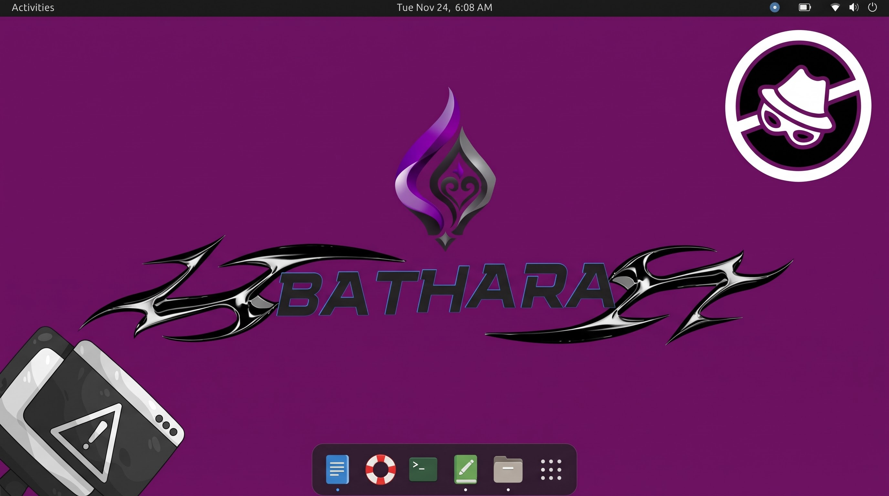

<div align="center">
  
  <h1>BHATARA OS v2.0.1.2 (Termux Edition)</h1>
  <p>
    <strong>Lingkungan Desktop Linux Ubuntu 22.04 (Jammy Jellyfish) + XFCE4 di Android tanpa Root</strong><br/>
    <em>Ubuntu 22.04 (Jammy Jellyfish) + XFCE4 Linux Desktop Environment on Android without Root</em>
  </p>
</div>

---

## Tampilan Desktop / Desktop Showcase

| **`jammy:gnome` (GNOME)** | **`jammy:xfce4` (XFCE4 - Utama)** | **`jammy:mate` (MATE)** |
| :---: | :---: | :---: |
|  |  |  |
| Tampilan desktop GNOME | Tampilan utama ringan BHATARA OS | Tampilan desktop MATE |

---

## Prasyarat Sistem / System Requirements

* **Perangkat / Device:** Android ARM64 (`aarch64`), disarankan Android 10–16.
* **Aplikasi / Apps:**
  * [Termux](https://f-droid.org/packages/com.termux/) (wajib versi F-Droid atau GitHub Releases, bukan Play Store).
  * [AVNC](https://f-droid.org/packages/com.gaurav.avnc/) (aplikasi VNC Viewer untuk menampilkan layar desktop).
* **Penyimpanan / Storage:** Minimal ruang kosong **4 GB**.

---

## Pengaturan Wajib Android (Khusus Android 12–16 / HyperOS / OneUI)

> **Penting:** Lewati bagian ini hanya jika Anda menggunakan Android 11 ke bawah. Pada Android 12 hingga 16, sistem akan menghentikan proses Termux secara paksa (`[Process completed (signal 9)]`) jika pengaturan di bawah ini belum diaktifkan.

1. **Matikan Pembatasan Baterai Termux:**
   Buka *Setelan HP → Aplikasi → Termux → Baterai*, lalu pilih **Tidak ada pembatasan (*No restrictions*)**.
2. **Nonaktifkan Pembatasan Proses Turunan (*Child Process Restrictions*):**
   * Buka *Setelan → Tentang Ponsel*, ketuk **Versi OS / Build Number** sebanyak 7 kali hingga **Opsi Pengembang (*Developer Options*)** aktif.
   * Masuk ke *Setelan Tambahan → Opsi Pengembang*, cari dan aktifkan **Nonaktifkan pembatasan proses turunan (*Disable child process restrictions*)**.

---

## Panduan Instalasi Lengkap / Full Installation Guide

### 1. Persiapan Awal di Termux
```bash
pkg update && pkg upgrade -y
pkg install git unzip proot-distro wget curl -y
termux-setup-storage
termux-wake-lock
```

### 2. Kloning & Instal BHATARA OS
```bash
cd ~
git clone https://github.com/BHATARAOS/BHATARA-OS.git
cd ~/BHATARA-OS
chmod +x install.sh scripts/*.sh
./install.sh
```
*(Catatan: Jika unduhan rootfs terputus di tengah jalan karena koneksi internet, lanjutkan cukup dengan `udroid install jammy:xfce4`).*

### 3. Terapkan Tema & Branding BHATARA OS
```bash
cd ~/BHATARA-OS
sed -i 's|/var/lib/proot-distro/installed-rootfs|/var/lib/udroid/installed-filesystems|g' scripts/apply-bhatara-theme.sh
bash scripts/apply-bhatara-theme.sh
```

### 4. Konfigurasi Desktop & Server VNC
Masuk ke sistem BHATARA OS:
```bash
udroid login jammy:xfce4
```

Setelah prompt berubah menjadi `root@localhost:~#`, jalankan perintah berikut:
```bash
mkdir -p ~/.vnc
cat << 'INNER_EOF' > ~/.vnc/xstartup
#!/bin/sh
unset SESSION_MANAGER
unset DBUS_SESSION_BUS_ADDRESS
export XDG_RUNTIME_DIR=/tmp/runtime-root
mkdir -p $XDG_RUNTIME_DIR
chmod 700 $XDG_RUNTIME_DIR
exec dbus-launch --exit-with-session startxfce4
INNER_EOF
chmod +x ~/.vnc/xstartup

vncserver -kill :1 2>/dev/null ; rm -rf /tmp/.X1-lock /tmp/.X11-unix/X1 /root/.vnc/*.pid
vncserver :1 -localhost yes -SecurityTypes None -geometry 1280x720 -depth 24
```

### 5. Hubungkan ke Aplikasi AVNC
1. Biarkan **Termux** tetap berjalan di latar belakang.
2. Buka **AVNC**, ketuk **`+`**, isi **Host:** `127.0.0.1`, **Port:** `5901`, kosongkan **Password**, lalu ketuk **Save** dan hubungkan.

---


<h2>🎨 Instalasi &amp; Menjalankan Varian Desktop Tambahan (GNOME &amp; MATE)</h2>
<p>Selain tampilan utama ringan default (<b>XFCE4 / <code>jammy:xfce4</code></b>) di atas, Anda juga dapat menginstal dan menjalankan varian <b>MATE</b> atau <b>GNOME</b> melalui shell <b>Termux (<code>~ $</code>)</b>:</p>

<h3>1. Instal &amp; Jalankan Varian MATE (<code>jammy:mate</code>)</h3>
<p><b>Langkah Instalasi (jalankan di Termux <code>~ $</code>):</b></p>
<pre><code>termux-wake-lock &amp;&amp; udroid install jammy:mate</code></pre>
<p><b>Menjalankan Desktop MATE di AVNC:</b></p>
<pre><code>udroid login jammy:mate</code></pre>
<p>Setelah masuk ke prompt Ubuntu (<code>root@localhost:~#</code>), atur sesi VNC dan nyalakan server:</p>
<pre><code>mkdir -p ~/.vnc &amp;&amp; printf '#!/bin/sh\nunset SESSION_MANAGER\nunset DBUS_SESSION_BUS_ADDRESS\nexport XDG_RUNTIME_DIR=/tmp/runtime-root\nmkdir -p $XDG_RUNTIME_DIR &amp;&amp; chmod 700 $XDG_RUNTIME_DIR\nexec dbus-launch --exit-with-session mate-session\n' &gt; ~/.vnc/xstartup &amp;&amp; chmod +x ~/.vnc/xstartup &amp;&amp; vncserver :1 -localhost yes -SecurityTypes None -geometry 1280x720 -depth 24</code></pre>

<h3>2. Instal &amp; Jalankan Varian GNOME (<code>jammy:gnome</code>)</h3>
<p><b>Langkah Instalasi (jalankan di Termux <code>~ $</code>):</b></p>
<pre><code>termux-wake-lock &amp;&amp; udroid install jammy:gnome</code></pre>
<p><b>Menjalankan Desktop GNOME (Mode Flashback) di AVNC:</b></p>
<pre><code>udroid login jammy:gnome</code></pre>
<p>Setelah masuk ke prompt Ubuntu (<code>root@localhost:~#</code>), pasang komponen VNC beserta sesi GNOME Flashback (stabil tanpa <code>systemd</code> di <code>proot</code>), lalu nyalakan server:</p>
<pre><code>apt update &amp;&amp; apt install -y tigervnc-standalone-server dbus-x11 gnome-panel metacity gnome-menus gnome-flashback feh &amp;&amp; mkdir -p ~/.vnc &amp;&amp; printf '#!/bin/sh\nunset SESSION_MANAGER\nunset DBUS_SESSION_BUS_ADDRESS\nexport XDG_RUNTIME_DIR=/tmp/runtime-root\nmkdir -p $XDG_RUNTIME_DIR &amp;&amp; chmod 700 $XDG_RUNTIME_DIR\nexport XDG_CURRENT_DESKTOP=GNOME-Flashback:GNOME\nexport XDG_MENU_PREFIX=gnome-\nmetacity --replace &amp;\ngnome-flashback &amp;\nexec dbus-run-session -- gnome-panel\n' &gt; ~/.vnc/xstartup &amp;&amp; chmod +x ~/.vnc/xstartup &amp;&amp; vncserver :1 -localhost yes -SecurityTypes None -geometry 1280x720 -depth 24</code></pre>

<p><b>Koneksi AVNC &amp; Menutup Sesi:</b> Buka aplikasi <b>AVNC</b> lalu sambungkan ke <code>127.0.0.1</code> port <code>5901</code> (kosongkan kolom kata sandi). Sebelum berpindah varian desktop, matikan server VNC di dalam Ubuntu dengan perintah <code>pkill -9 -f Xtigervnc ; rm -rf /tmp/.X*-lock /tmp/.X11-unix/X* /root/.vnc/*.pid ; exit</code>.</p>

## Penggunaan Sehari-hari / Daily Usage

**Menyalakan Kembali BHATARA OS:**
```bash
termux-wake-lock
udroid login jammy:xfce4
vncserver :1 -localhost yes -SecurityTypes None -geometry 1280x720 -depth 24
```

**Mematikan BHATARA OS dengan Aman:**
```bash
vncserver -kill :1
exit
termux-wake-unlock
```

---

## Kontribusi & Lisensi / Contributing & License

* Kontribusi selalu diterima dengan senang hati melalui **Pull Request** maupun **Issues**.
* Dibangun di atas fondasi open-source [ubuntu-on-android (Udroid)](https://github.com/RandomCoderOrg/ubuntu-on-android) oleh **RandomCoderOrg** di bawah lisensi **MIT License**.
